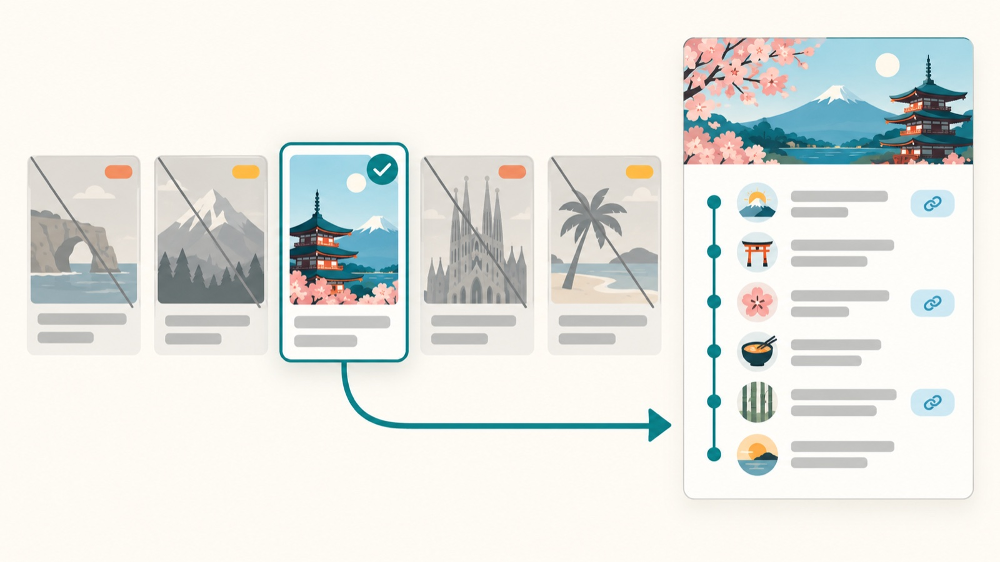
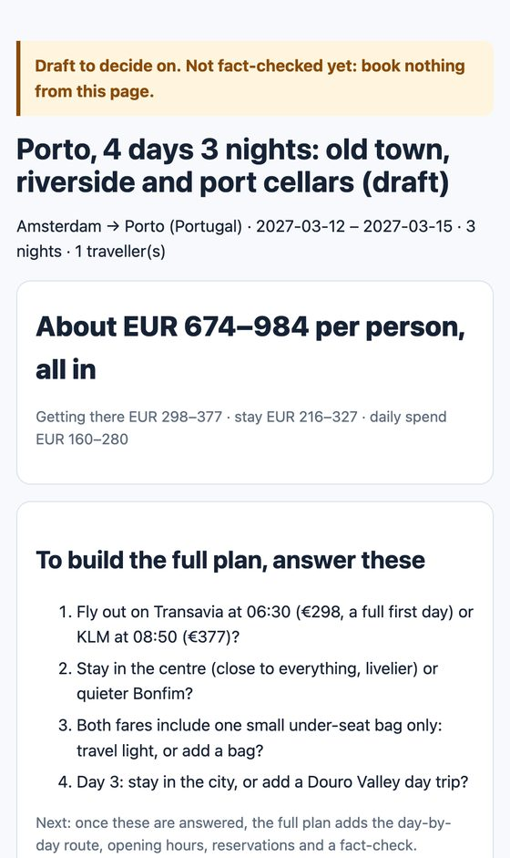

# travel-buddy: decide *where to go* first, then get a plan you can actually book

<p align="center">
  <a href="README_CN.md"><strong>简体中文</strong></a>
</p>

<p align="center">
  <a href="LICENSE"></a>
  
  
  <a href="https://clawhub.ai/dong845/skills/travel-buddy"></a>
  <a href="https://skillhub.cn/skills/user_f486c577/travel-buddy"></a>
</p>

<p align="center">
  
</p>

<p align="center"><sub>Free and open source · runs on your own machine · no account, no cloud</sub></p>

> **A travel planner that won't invent a price, won't call a trip bookable before it has checked the last train home, and won't plan your days before it knows the place is reachable.**

Ask most AI planners "7 days, €1,500, where should I go?" and you get an itinerary for a city you never chose. travel-buddy does it in order: first **where** (candidates, hard filters, and what it rejected and why), then **a quick draft** you can say yes or no to, and only then **the full plan**, a single HTML page with real routes, real booking links and a per-person budget whose every line has a source and a date.

It is a skill for [Claude Code](https://claude.ai/code) and [Codex](https://openai.com/codex). You talk to it in the terminal; it collects your needs through a local browser form, researches live, and saves the result to a folder you own.

| 🧭 **1 · Where** | 📝 **2 · Draft** | ✅ **3 · Checked plan** |
| :---: | :---: | :---: |
| Candidates filtered by entry, travel time, budget and your limits | Real fares and hotel prices, an all-in cost, and the open questions, in minutes | Day-by-day page, fact-checked by independent checkers, ready to book from |

---

## What you can ask

| You have | You get |
| --- | --- |
| No destination, or just a continent | 3–5 ranked places, with trade-offs and what was ruled out |
| A country, no city | Cities and regions compared before any planning |
| A destination | A draft in minutes, then a full day-by-day plan |
| A saved plan and a change | Only what the change affects is redone |

```text
Use travel-buddy — 7 days in May, about €1,500, from Amsterdam. Where should I go?
Use travel-buddy — 8 days in Japan in autumn; help me pick the cities first.
Use travel-buddy — Milan, 5–7 February, €600–750, no long walks.
Use travel-buddy — my saved plan moved a week later. What changes?
```

---

## What you get

<table>
<tr>
<td width="56%" valign="top">
<p><b>First, a draft page</b> (right): real fares, real nightly prices for one or two areas, an all-in cost the script adds up, a one-line outline per day, and the questions the full plan needs answered. If the trip doesn't work, you find out here.</p>
<p><b>Then, the full plan</b>, a page you can keep on your phone:</p>
<ul><li>💶 the all-in cost per person and what to book first</li><li>🗓️ every day as a timeline, with a map link for each leg</li><li>🍝 meals with ratings and opening hours for that weekday</li><li>🏨 hotel and flight cards that open the exact listing</li><li>🚕 a "show the driver" card with each hotel's local address</li><li>🛂 entry rules, payment, roaming and emergency numbers</li></ul>
</td>
<td width="44%" valign="top">

<br><sub>A real draft (Amsterdam → Porto), prices checked 2026-11-26</sub>
</td>
</tr>
</table>

Saved as plain files in `~/Travel Buddy/`:

| File | What it is |
| --- | --- |
| `html/<date>-<title>.html` | The plan page described above, self-contained and readable offline |
| `plans/<date>-<title>.json` | The same plan as data, with every source and assumption |
| `plans/<date>-<title>.ics` | A calendar file: the flights you chose, your stays, meals and timed stops, at the right local time |

Anything not checked is labelled as unchecked, and a plan that skipped fact-checking shows a **"not fact-checked"** banner at the top.

**Before you book**, it re-checks a saved plan: how old each fact is, and whether the flights are still on sale at the same price. **After the trip**, it asks once how it went (pace, walking, hotel, food) and saves the answers to your profile, so the next plan fits better.

---

## Why you can trust the plan

- 🧭 **Where before what.** A destination that fails a hard constraint (entry, travel time, budget, mobility) cannot win on charm.
- 🧾 **Every price, hour and entry rule has a source and a date.** Where it couldn't check, the page says so.
- 🕵️ **Checked by someone who didn't write it.** Five independent checkers (entry, transport, sights and opening hours, bookings, season) and two auditors (internal consistency, completeness) review each plan in fresh sessions. The session that wrote the plan can't sign it off.
- 🗺️ **Map data, not the plan's own numbers.** Every map pin, restaurant and walk is checked against OpenStreetMap, including Amap pins in China. A hotel pin 1.4 km off, or a "22-minute walk" that is really 38, gets caught.
- 🔗 **Links you can use.** Hotel buttons open the property itself, or say clearly that they open a search.
- 🚦 **Gates, not good intentions.** Scripts such as `check_plan_consistency.py` check every plan before it is saved: budgets that add up, walks within your limit, meals inside opening hours, a calendar with no gaps.
- 🛡️ **Browse, never buy.** It never logs in, pays or books. You do that, from the links.

---

## Install

Requires **Python 3.10+**. No `pip install`: every script uses the standard library only.

**`npx skills`** (simplest):

```bash
npx skills add dong845/travel-buddy
```

**Claude Code plugin** (managed updates):

```text
/plugin marketplace add dong845/travel-buddy
/plugin install travel-buddy@travel-buddy
/reload-plugins
```

It is then `/travel-buddy:travel-buddy`. Remove any manual copy in `~/.claude/skills/` so it doesn't appear twice. Run `/plugin marketplace update travel-buddy` for new releases.

**Clone and link** (if you want to edit it):

```bash
git clone --depth 1 https://github.com/dong845/travel-buddy.git ~/code_project/travel-buddy
ln -s ~/code_project/travel-buddy ~/.claude/skills/travel-buddy
```

**[ClawHub](https://clawhub.ai/dong845/skills/travel-buddy)** (OpenClaw):

```bash
openclaw skills install @dong845/travel-buddy
```

It is also listed on **[SkillHub](https://skillhub.cn/skills/user_f486c577/travel-buddy)**.

Then create the workspace once:

```bash
python scripts/travel_workspace.py init     # makes ~/Travel Buddy/{profiles,plans,html}
```

## Use

Type `/travel-buddy`, or just describe the trip. It opens a local form (`http://127.0.0.1:<port>/?token=…`); fill it in, and the assistant you're talking to takes it from there. It never starts a second agent behind your back. You never paste JSON or type "continue".

```bash
python scripts/start_intake_workflow.py --assistant auto   # the guided form
python scripts/start_intake_workflow.py --edit-profile     # change saved preferences first
python scripts/start_intake_workflow.py --detach           # if your CLI can't run commands in the background
```

---

## Privacy and security

- **Stored, only after you tick the consent box:** home city, airports, currency, pace, lodging style, accessibility and dietary needs, places visited or excluded, and a residence-status *category* (for entry rules).
- **Never stored:** passport or document numbers, payment details, passwords, exact home address. The form rejects them.
- **The form** runs only on `127.0.0.1`, on a random port, behind a one-time token, and accepts one submission. The pages it makes contain no third-party script.
- **What leaves your machine:** research queries; flight searches to Kiwi.com (route, dates, party size only); place checks to OpenStreetMap (place names and coordinates only); Amap place searches in mainland China if you set `AMAP_KEY`; photo lookups on Wikimedia; and visits to the links on the page, to check where they land.

To delete a profile, remove that one file from `~/Travel Buddy/profiles/`.

---

## Troubleshooting

**It refuses to save: "No verification report."** The gate is working. Run the check described in [`references/verification.md`](references/verification.md), or save with `--unverified` to keep a draft that says on the page it wasn't fact-checked.

**Nothing happened after I submitted the form.** That's normal inside an assistant: the saved path goes back to the assistant you're already using. Use `--assistant codex` or `--assistant claude` only if you want a separate planner.

**"Unsupported trip request format."** The form's mode and destination scope contradict each other (for example "find me a destination" with a fixed city). Fix one and submit again.

---

How it works inside, script by script: **[docs/internals.md](docs/internals.md)**. You don't need it to use travel-buddy.

## License

MIT, see [LICENSE](LICENSE).
