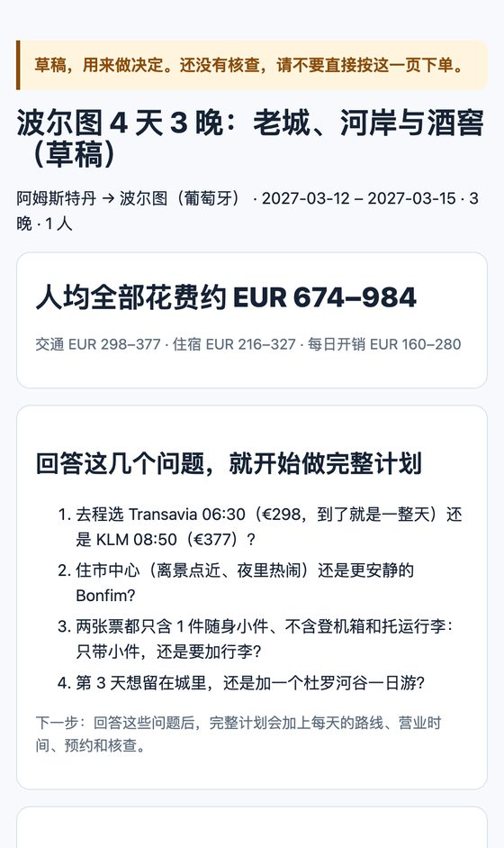

# travel-buddy：先想清楚「去哪儿」，再给你一份真能照着订的行程

<p align="center">
  <a href="README.md"><strong>English</strong></a>
</p>

<p align="center">
  <a href="LICENSE"></a>
  
  
  <a href="https://clawhub.ai/dong845/skills/travel-buddy"></a>
  <a href="https://skillhub.cn/skills/user_f486c577/travel-buddy"></a>
</p>

<p align="center">
  
</p>

<p align="center"><sub>免费开源 · 在你自己的电脑上运行 · 无账号、无云端</sub></p>

> **一个不编价格、没确认末班车之前不说「可以订了」、没确认到得了之前不排逐日行程的旅行助手。**

问大多数 AI 行程工具「7 天、1500 欧，去哪儿？」，你会直接拿到一份逐日行程，而那座城市你从没选过。travel-buddy 按顺序来：先决定**去哪儿**（候选、硬性条件、淘汰了什么和为什么），再给你一份**几分钟出来的草稿**让你拍板，最后才做**完整行程**：一个 HTML 页面，路线和预订链接都是真的，人均预算的每一行都有来源和核对日期。

它是给 [Claude Code](https://claude.ai/code) 和 [Codex](https://openai.com/codex) 用的 skill。你在终端里跟它说话，它用本机浏览器表单收集需求、实时查资料，最后把结果存进你自己的文件夹。

| 🧭 **1 · 去哪儿** | 📝 **2 · 草稿** | ✅ **3 · 核查过的行程** |
| :---: | :---: | :---: |
| 按入境、路上时间、预算和你的限制筛选候选 | 几分钟给出真实票价、房价、人均总花费和待你回答的问题 | 逐日行程页，经独立核查，可以照着订 |

---

## 你可以这样问

| 你手上有 | 你会拿到 |
| --- | --- |
| 还没目的地，或只有一个大洲 | 3–5 个排好序的地方，附取舍和被排除的原因 |
| 有国家，还没定城市 | 先比较城市和地区，再谈行程 |
| 目的地已定 | 几分钟出草稿，再出完整的逐日行程 |
| 已有方案，条件变了 | 只重做受影响的部分 |

```text
用 travel-buddy —— 五月有 7 天、预算 1500 欧左右，从阿姆斯特丹出发，我该去哪儿？
用 travel-buddy —— 秋天想去日本玩 8 天，先帮我把城市定下来。
用 travel-buddy —— 米兰，2 月 5–7 日，600–750 欧，不要长距离步行。
用 travel-buddy —— 我存好的方案往后挪了一周，哪些要改？
```

---

## 你会拿到什么

<table>
<tr>
<td width="56%" valign="top">
<p><b>先是一页草稿</b>（右图）：真实机票价、一两个区域的真实每晚房价、脚本自己加总的人均全部花费、每天一行的安排，以及做完整计划前需要你回答的问题。这趟行不通的话，在这一步就知道了。</p>
<p><b>然后是完整行程</b>，一个可以存在手机上的页面：</p>
<ul><li>💶 人均全部花费，和先订什么</li><li>🗓️ 每天的时间线，每一段都有地图链接</li><li>🍝 餐厅带评分和当天的营业时间</li><li>🏨 酒店和机票卡片直接打开对应页面</li><li>🚕 「给司机看的地址」卡片，写着每家酒店的当地地址</li><li>🛂 入境规定、付款、漫游和紧急电话</li></ul>
</td>
<td width="44%" valign="top">

<br><sub>真实草稿示例（阿姆斯特丹 → 波尔图），价格核对于 2026-11-26</sub>
</td>
</tr>
</table>

以普通文件存在 `~/Travel Buddy/`：

| 文件 | 是什么 |
| --- | --- |
| `html/<日期>-<标题>.html` | 上面说的行程页，自包含，离线可读 |
| `plans/<日期>-<标题>.json` | 同一份方案的数据版，带所有来源和假设 |
| `plans/<日期>-<标题>.ics` | 日历文件：你选定的航班、住宿、用餐和定时安排，时间对得上当地时区 |

没核实的内容都会标明；跳过核查的方案，页面顶部会显示**「未核查」**横幅。

**订之前**，它会重新检查已存的方案：每条信息多久没核对了、航班是否还在卖、价格变没变。**旅行结束后**，它会问一次玩得怎么样（节奏、步行、酒店、吃饭），把答案存进你的档案，下次的方案会更合适。

---

## 为什么这份行程靠得住

- 🧭 **先定去哪，再排怎么玩。** 不满足硬性条件（入境、路上时间、预算、行动能力）的目的地，再吸引人也不会胜出。
- 🧾 **每个价格、营业时间和入境规定都有来源和日期。** 查不到的，页面会写明。
- 🕵️ **不由写方案的那一方自己核查。** 五个独立核查员（入境、交通、景点和营业时间、预订、季节）和两个审计（内部一致性、完整性）在全新的会话里审每份方案；写方案的会话不能自己签字。
- 🗺️ **用地图数据核对，不信方案自己的数字。** 每个地图点、餐厅和步行时间都用 OpenStreetMap 核对，国内的高德坐标也会换算后核对。酒店针脚偏了 1.4 公里、写着 22 分钟实际要走 38 分钟，都会被查出来。
- 🔗 **链接能直接用。** 酒店按钮直接打开那家酒店；只能打开搜索结果的，会写明是搜索。
- 🚦 **规则写成脚本，不靠自觉。** `check_plan_consistency.py` 等脚本在保存前检查每份方案：预算加得对、步行不超你的上限、吃饭时间在营业时间内、每天都排到了。
- 🛡️ **只看不买。** 它从不登录、付款或下单，这些由你自己通过链接完成。

---

## 安装

需要 **Python 3.10+**。不用 `pip install`，所有脚本只用标准库。

**`npx skills`**（最省事）：

```bash
npx skills add dong845/travel-buddy
```

**Claude Code 插件**（自动管理更新）：

```text
/plugin marketplace add dong845/travel-buddy
/plugin install travel-buddy@travel-buddy
/reload-plugins
```

装好后调用方式是 `/travel-buddy:travel-buddy`。如果 `~/.claude/skills/` 里还有手动装的副本，请删掉，否则会出现两次。新版本用 `/plugin marketplace update travel-buddy` 更新。

**克隆并链接**（想自己改的话）：

```bash
git clone --depth 1 https://github.com/dong845/travel-buddy.git ~/code_project/travel-buddy
ln -s ~/code_project/travel-buddy ~/.claude/skills/travel-buddy
```

**[ClawHub](https://clawhub.ai/dong845/skills/travel-buddy)**（OpenClaw）：

```bash
openclaw skills install @dong845/travel-buddy
```

也已上架 **[SkillHub](https://skillhub.cn/skills/user_f486c577/travel-buddy)**。

然后建一次工作区：

```bash
python scripts/travel_workspace.py init     # 建立 ~/Travel Buddy/{profiles,plans,html}
```

## 使用

输入 `/travel-buddy`，或直接说你的行程需求。它会打开一个本地表单（`http://127.0.0.1:<端口>/?token=…`），填完后由你正在对话的助手接着做，不会在背后另起一个代理。你不用粘贴 JSON，也不用输入「继续」。

```bash
python scripts/start_intake_workflow.py --assistant auto   # 引导表单
python scripts/start_intake_workflow.py --edit-profile     # 先改已存的偏好
python scripts/start_intake_workflow.py --detach           # 你的命令行不能后台运行命令时用
```

---

## 隐私与安全

- **只在你勾选同意后保存：** 常住城市、可用机场、币种、节奏、住宿偏好、无障碍和饮食需求、去过或不想去的地方，以及居留身份**类别**（用来判断入境规定）。
- **从不保存：** 护照或证件号码、支付信息、密码、详细住址。表单会直接拒收。
- **表单**只在 `127.0.0.1` 上、随机端口、凭一次性令牌访问，只接受一次提交。生成的页面里没有第三方脚本。
- **会离开你电脑的只有：** 查资料的请求；发给 Kiwi.com 的航班查询（只有航线、日期、人数）；发给 OpenStreetMap 的地点核对（只有地名和坐标）；设置了 `AMAP_KEY` 时发给高德的国内地点查询；Wikimedia 的图片查询；以及为了确认落地页面而访问页面上的链接。

要删除档案，删掉 `~/Travel Buddy/profiles/` 里对应的那一个文件即可。

---

## 遇到问题

**保存时提示「No verification report」。** 这是核查关卡在起作用。按 [`references/verification.md`](references/verification.md) 跑一遍核查；或者用 `--unverified` 存成草稿，页面上会写明未核查。

**提交表单后没反应。** 在助手里使用时这是正常的：保存路径会交回给你正在用的助手。只有想另起一个规划器时才用 `--assistant codex` 或 `--assistant claude`。

**提示「Unsupported trip request format」。** 表单里的模式和目的地范围互相矛盾（比如选了「帮我找目的地」却写死了一个城市）。改掉其中一个再提交。

---

内部是怎么工作的、每个脚本做什么：**[docs/internals_CN.md](docs/internals_CN.md)**。只是使用的话不需要看。

## 开源协议

MIT，见 [LICENSE](LICENSE)。
